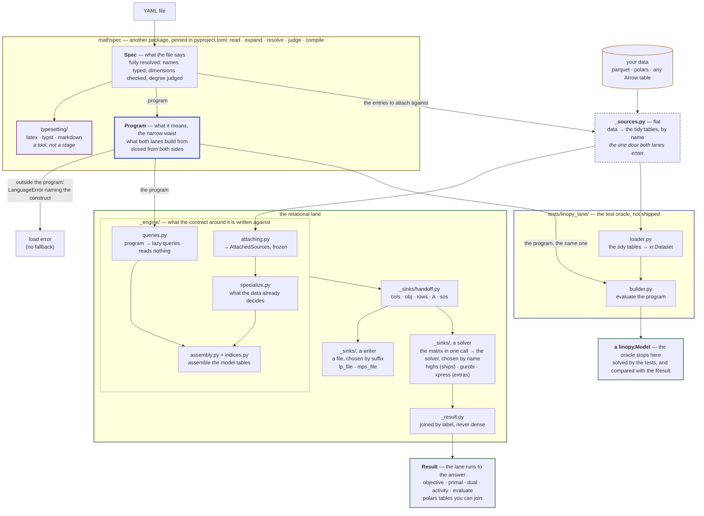

# Architecture

How the package is put together, for anyone who changes its structure or adds
a sink or an operator. A PR that changes the structure described here updates
this page.

[The walkthrough](walkthrough.md) runs the pipeline stage by stage. Its output,
[walkthrough.out](https://github.com/fluxopt/specsolve/blob/main/examples/walkthrough/walkthrough.out),
is asserted line for line by `tests/test_walkthrough.py`.

## The pipeline

A spec compiles to a **closed program known before any data is touched**, so
it can be built two ways that mean the same thing. The package's build is the
*relational lane* (`_engine/`, `_sinks/` and the modules both read), a program
streamed to a sink. The test suite's
is *the oracle* (`tests/linopy_lane/`), a `linopy.Model`.

- **The language is another package.** `mathspec` reads a file and compiles it
  to a `Program`. It cannot import anything here.
- **Data enters through one door, and both lanes use it.**
  `_sources.tidy_sources` reads every shape [the data contract](../reference/data.md)
  accepts into tidy polars tables, and `_assumptions.py` checks a spec's
  assumptions there.
- **One gate decides what either lane builds.** `_inputs.as_program` returns a
  `Program` or raises `LanguageError`. `DataError` is what a source failed to
  supply. A spec the language accepts and this lane cannot build raises
  `SpecsolveError`, naming the rewrite.

## The public API

**Three modules hold the public API.** `specsolve` holds what a caller calls,
`specsolve.types` every type a call returns, and `specsolve.errors` what a call
raises or warns, the language's errors included. Every other module starts
with an underscore and is internal. `tests/test_architecture.py` pins each
`__all__` and refuses a new module named without one, and
[the Python API](../reference/api.md) renders the docstrings.

**Nothing in the public API constructs math or reaches the program.** The YAML file
is the model, and Python runs it.

## Hard rules

*`tests/test_architecture.py` encodes these, and CI's bare-install job proves
the dependency claims.*

0. **The layers are ordered, and imports prove it.** Every module imports only
   downward, at module level. An undeclared in-function import fails the build
   (`DELIBERATE_LAZY_IMPORTS`).
1. **The program is the whole language, and the language is upstream.** The
   program that crosses is fully resolved: macros and named expressions without
   `cases:` are substituted, and `Spec.expand` expands `piecewise:` first.
   Every `mathspec` import names the package, never a module inside it.
2. **The engine knows nothing about linopy, xarray or YAML.** It imports
   nothing from the package but `errors.py` and `_messages.py`
   (`ENGINE_MAY_IMPORT`), and no contract module names a module inside it.
3. **One language, two builds, and linopy is only the oracle.** Both pass
   `_inputs.as_program`, and nothing under `src/` imports linopy. The three files
   that build on one side only are in
   [Verification](verification.md#the-same-language-but-not-every-build).
4. **A YAML file is self-contained.** No Python-side state may change what a
   file means.
5. **The public interface is a declared spec, not a Python API.** There is no
   API to construct a spec, hand in a program, or populate a registry
   ([the public API](#the-public-api)).

## The program, node for node

**The program is the vocabulary both lanes speak.** The table gives what the file
writes and what the relational query does with it. The oracle's call is in
[what a construct becomes in the oracle](verification.md#what-a-construct-becomes-in-the-oracle).
`tests/test_docs_site.py` holds the table to `mathspec.program.Expression`'s
subclasses.

**Fan-in** says how an output row's slots relate to the input's
(`terms.fan_in`). Anything but one-to-one mixes several slots into one row, so
absence is pushed into the operand first
([#1142](https://github.com/fluxopt/specsolve/issues/1142)).

| program node | the file writes | fan-in | the relational query |
| --- | --- | --- | --- |
| `Constant` | a number | one-to-one | a one-row constant term |
| `ParameterReference` | a declared name | one-to-one | its table as `(dims…, cval)` |
| `VariableReference` | a declared name | one-to-one | `(dims…, col_index, coeff=1)`, plus where it exists; at a read, its primal as a constant term with the same presence, a zero at every absent slot under `missing: neutral` |
| `Dual` | `dual(c)` | one-to-one | at a read only: the constraint's rows beside its share of the dual vector, a constant term present exactly where a row stands |
| `Negate` | `-x` | one-to-one | the value column negated |
| `Add` | `x + y`, `x - y` | one-to-one | the two lists of terms concatenated |
| `Multiply` | `x * y` | one-to-one | a join on the shared dimensions, a constant factor with a reduction under it added up to one value per coordinate first; two variable factors pair into a quadratic term |
| `Divide` | `x / p` | one-to-one | a **left** join, so a divisor parameter with no row leaves a null to report; where the divisor is absent, so is the quotient; a divisor with a reduction under it is added up to one value per coordinate first; at a read, a divisor that is zero makes the quotient absent |
| `Power` | `p ** q` | one-to-one | an inner join and `pow`, each side with a reduction under it added up to one value per coordinate first |
| `Sum` | `sum(x)`, `sum(x, over=d)`, `sum(x, over=c, by=r[d])` | many-to-one | the summed dimensions projected away — no aggregate; over the axes of a `Join` under it, one inner join with the relation's table on the columns the join matches, the dropped dimensions traded for the added ones, and a bare relation fans a label out to every group |
| `Join` | `at(x, by=r[d])` | one-to-one | the relation's table joined on the columns read, the key coming back, fanning out; a `Join` that opens axes stands only under the `Sum` over them |
| `Translate` | `shift(x, along=d, offset=n)` | one-to-one | a remap through the dimension's `POSITION`, modulo its size under `wrap` |
| `WindowSum` | `sum_back(x, along=d, window=w)` | one-to-many | a row lands at every position whose window reaches it — no aggregate |
| `Cases` | a named expression's `cases:` block | one-to-one | each region's value cut to its own condition and the lists of terms concatenated |
| `ExpressionReference` | the name of an `expressions:` entry | one-to-one | its body, queried where the name stands |

**The engine only builds.** Every refusal about the shape of a file is made
upstream. The engine raises `DataError` about the data, and `SpecsolveError`
for the one construct the language accepts and this lane cannot build (#1137).

**Neither reduction aggregates.** A `Sum` drops columns or, through a
relation, swaps them, and a `WindowSum` replicates rows. Every duplicate collapses once, in the
terminal `SUM(coeff) GROUP BY row, col` at assembly.

## The relational lane

**The spine is one module per box**: `attaching.py`, `specialize.py`,
`queries.py`, `assembly.py`, `_sinks/`, and `engine.py`, which runs the
lifecycle. `scope.py` sits under them all.

**`AttachedSources` and `BuiltModel` are frozen**, so a build that raises
leaves no model.

**Tables are tidy.** The engine's own columns are named once, in `_names.py`,
under the `specsolve_` prefix a dimension cannot take. Parameters are
`(dims…, value)`. A variable table is `(dims…, COL)`. A linear expression is `(dims…, COL, COEFF)` plus a
constant term. An absent coordinate is a missing row, and broadcasting is a join.

**A term over data with a row at every coordinate is also held by position**
(`positional.py`). A coordinate's row-major position is then the key, and an
alignment is an index rather than a join. Such a term still carries its tidy
table, so an operator with no positional arm reads the table and the term is a
table from there on. Negation, a product with a constant term, a constraint's
share of the matrix and its right-hand side have a positional arm. A
constraint takes the share's only when every linear term it holds is held by
position, and the right-hand side's only when every constant term is. A
`where` and a bound read such a parameter at each row's position as well, from
100,000 coordinates up and where the row's labels are their own ordinals
(`Scope.parameter_join`).
Every such read is a polars expression over a table of positions, so it runs
on the threads and the memory the rest of the build uses.
`pixi run test-by-join` builds the whole suite with nothing read by position.

**Solver indices are dense `0..n-1`, row-major over the coordinate product, absent coordinates skipped.**
So `COL` is the solver column, `ROW` is the solver row, and a build is
the same from run to run. `update` puts new bounds, costs and right-hand sides
onto a loaded solver by position.

**The program is affine.** No node adds variables or constraints. Binary and
integer are a column type, `sos:` is a fourth stream, and `Spec.expand` writes
a formulation out.

**A table is the boundary in both directions.** `_tables.py` reads a caller's
table through the Arrow PyCapsule protocol, and a `Result` hands back polars.

**Sinks take four streams**: `cols`, `rows`, `A` in CSR, and `sos`. A sink
declares what it can ingest (`_sinks/capabilities.py`). A solver is chosen by
name from `SOLVERS`, and a writer by suffix from `WRITERS`.

## Module map

| Module | Role |
|---|---|
| `mathspec` (a dependency) | the whole language |
| `_api.py` | the functions that take a spec, and `Model` |
| `_archive_layout.py` | what an archive holds |
| `_archive.py` | reads an archive back: `load_archive`, `scan_archive` and `load_inputs` |
| `_inputs.py` | `SpecLike` and `Source`, what every function takes |
| `_collect.py` | how polars materialises a lazy table |
| `_parquet.py` | every parquet file, through polars, or pyarrow where polars has none |
| `_sources.py` | the door: caller data into tidy tables |
| `_start.py` | what a solve starts from: `Start`, read against a build and cut for a sweep's slices |
| `_assumptions.py` | a spec's `assumptions:` and a curve's conditions, checked against the data |
| `_tables.py` | caller tables in, via the Arrow PyCapsule protocol |
| `types.py` | public: every type a call returns |
| `errors.py` | public: the error tree |
| `_messages.py` | a wording two modules raise |
| `_solve_over.py` | a sweep's driver: one plan per slice, folded |
| `_axes.py` | how a sweep cuts its sources, what each slice is built from, and the stitch back |
| `_sweep.py` | `Sweep`, the one layout a spill, a save and an archive hold it in, and `load_sweep` / `scan_sweep` |
| `_engine/scope.py` | the program, its attached data and the variable tables built so far |
| `_engine/queries.py` | program → lazy queries |
| `_engine/relations.py` | a relation's table as a walk reads it |
| `_engine/shifts.py` | `shift` and `sum_back` |
| `_engine/conditions.py` | a `where:` condition as a boolean query |
| `_engine/terms.py` | the terms an expression turns into: linear, quadratic or constant |
| `_engine/positional.py` | data read by position instead of joined, where it has a value at every coordinate of its dimensions |
| `_status.py` | solve outcome on two axes |
| `_engine/indices.py` | which coordinate gets which solver index |
| `_engine/attaching.py` | the door's tables → `AttachedSources` |
| `_engine/specialize.py` | what the data decides before an entry is built |
| `_engine/assembly.py` | one build: every entry into the model tables |
| `_engine/coverage.py` | is the data there where an entry reads it |
| `_engine/readback.py` | a row, a solve and a named expression, read back by coordinate |
| `_engine/engine.py` | the lifecycle: build, hand to a sink, read back |
| `_result.py` | what a solve returned, its save on disk, and `load_result` / `scan_result` |
| `_outputs.py` | what an answer carries: the kinds of table, and the outputs a solve is asked for |
| `_records.py` | the rows an answer records: `Record`, `Metrics` and `Provenance` |
| `_answer_layout.py` | an answer on disk, and the `ANSWER_LAYOUT` stamp |
| `_names.py` | the columns specsolve writes beside a spec's own |
| `_sinks/handoff.py` | what every sink reads |
| `_sinks/capabilities.py` | what a sink can ingest |
| `_sinks/` | how a built model leaves: a solver by name, a writer by suffix ([README](https://github.com/fluxopt/specsolve/blob/main/src/specsolve/_sinks/README.md)) |

**The lane imports nothing else from the package but `errors.py` and
`_messages.py`.** The lane is `_engine/`, `_sinks/`, `_answer_layout.py`,
`_collect.py`, `_names.py`, `_outputs.py`, `_parquet.py`, `_records.py`,
`_result.py` and `_status.py` (`LANE`). No module imports linopy, and none imports xarray at module
level.

## Internal names

The names the code uses for its own parts. The names a caller meets are in
[the glossary](../reference/glossary.md).

**Lane**
: One way to build a spec: the relational lane, which is this package, or the
  oracle, the linopy lane under `tests/linopy_lane/` that builds a
  `linopy.Model`.

**The door**
: `_sources.tidy_sources`, the one function both lanes read data through.

**Compiling**
: Turning a spec into its `Program`, through `_inputs.as_program`.

**Query builder**
: `QueryBuilder` (`queries.py`): turns a program's expressions into polars lazy
  queries, as an expression's linear, quadratic and constant terms
  (`ExpressionTerms`).

**Attached sources**
: The tidy tables as every query reads them: a dimension as `(LABEL, POSITION)`, a
  label column as an `Enum` in declared order. They also hold each test of a
  `where` or a `cases:` region that the data decides at every coordinate,
  read once for the assumptions and the build both.

**Term**, **presence** and **region**
: One additive term of an expression, over its own dimensions: linear,
  quadratic or constant; where the variable under it exists; the part of a
  `cases:` block it covers (`terms.py`).

**Solver index**
: The position of one column or row in the solver: a column index for a
  variable at a coordinate, a row index for a constraint at one
  (`indices.py`). A label is a dimension's member, never a solver index.

**Handoff**
: Everything a sink reads of a built model, and nothing more: the tables, the
  column and row vectors, the matrix a block at a time (`handoff.py`).

**Collect engine**
: Which polars engine materialises a table. A build within `IN_MEMORY_REACH`
  columns and rows uses the in-memory engine (`collect.py`).

**Parquet backend**
: Which library reads and writes a parquet file: polars, or pyarrow where
  polars has none, as in the browser (`parquet.py`).

**Structure digest**
: A digest of everything a re-solve may not change. A loaded solver keeps its
  model while the digest holds and every coefficient is within 1e-12 relative
  of the one it holds (`handoff.py`).

**Kind**
: One table family of an answer: `primal`, `dual`, `expression`, and each
  output `outputs=` asked for (`OUTPUT_KINDS`).

**Run stamp**
: The `specsolve_run` column an archive adds to every table. Names that start
  with `specsolve_` are reserved.

**Slice**, **stitch** and **spill**
: One model of a sweep; windowed tables put back over the dimension they cut;
  a sweep's answers on disk (`_axes.py`, `_sweep.py`).

**Carry** and **the wire**
: One slice's answer copied into the next slice's data; how a slice's sources
  cross to a worker (`_solve_over.py`).

## Extension checklists

**Add a macro or named expression:** edit YAML.

**Add a sink:** a module in `_sinks/` named for it, with its class in
`SOLVERS`, or one line keyed by suffix in `WRITERS`. Its dependency
sits behind an extra, imported inside the function. The
[README](https://github.com/fluxopt/specsolve/blob/main/src/specsolve/_sinks/README.md)
is the full list.

**Add a tool that reads a spec:** a package of its own that depends on
`mathspec`, not on this one.

**Add an operator:** first
[in mathspec](https://mathspec.readthedocs.io/en/latest/contributing/#adding-an-operator),
landed and tagged. Then here: the oracle's linopy call, the query builder's case, the
engine, and a differential test through a solver and the LP writer.
[The nightly canary](https://github.com/fluxopt/specsolve/blob/main/.github/workflows/canary.yml)
checks the two halves have not drifted.
