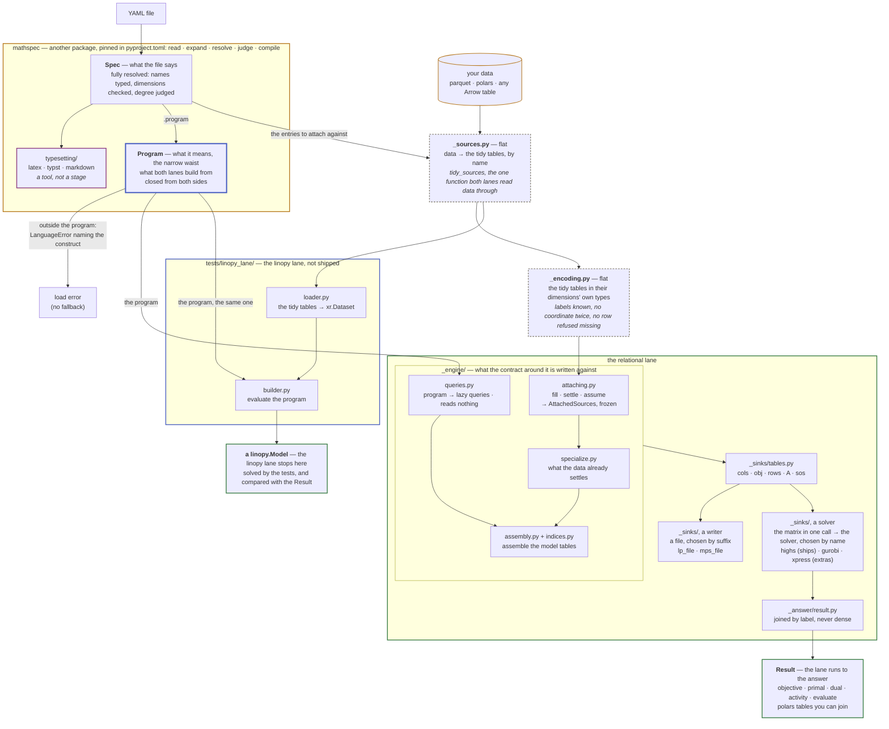

# Architecture

How the package is put together, for anyone who changes its structure or adds
a sink or an operator. A PR that changes the structure described here updates
this page.

[The walkthrough](walkthrough.md) runs the pipeline stage by stage. Its output,
[walkthrough.out](https://github.com/fluxopt/specsolve/blob/main/examples/walkthrough/walkthrough.out),
is asserted line for line by `tests/test_walkthrough.py`.

## The pipeline

A spec compiles to a **closed program known before any data is touched**, so
it can be built two ways that mean the same thing. The package's build is the
*relational lane* (`_engine/`, `_sinks/` and the modules both read), a program
streamed to a sink. The test suite's
is *the linopy lane* (`tests/linopy_lane/`), a `linopy.Model`.

- **The language is another package.** `mathspec` reads a file and compiles it
  to a `Program`. It cannot import anything here.
- **Both lanes read data through one function.**
  `_sources.tidy_sources` reads every shape [the data contract](../reference/data.md)
  accepts into tidy polars tables, and refuses a source that is not one.
- **Data reaches a build through one function, in seven steps.**
  `_api.attach_sources` reads a caller's sources and returns them twice: as
  the tidy tables, and as a build reads them. `tidy_sources` reads each
  source and holds it to its shape. `_encoding.encoded` turns each label into
  its dimension's own type and holds each table to its content: every label
  one its dimension has, no coordinate twice, and a row wherever the spec
  refuses to lack one. `attaching.attach` fills the missing rows a divisor
  reads, settles the conditions the data decides, and checks the spec's
  assumptions (`_engine/assumptions.py`). The first two need only what the
  spec declares and sit outside the engine. The last needs the program's
  expressions and conditions. The linopy lane calls `attach_sources` too.
- **One function decides what either lane builds.** `_inputs.as_program`, which
  every verb compiles a spec through, returns a `Program` or raises
  `LanguageError`. `DataError` is what a source failed to supply. A spec the language accepts and this lane cannot build raises
  `SpecsolveError`, naming the rewrite.

## The phases

**A model's life is clocked in nine phases, and every step is in exactly one.**
[`Metrics`](../reference/api.md#specsolve.types.Metrics) defines what each
phase covers, and [the timings guide](../howto/timings.md#the-phases-of-a-solve)
draws the phases for a caller. The clock
is one mark (`Clock`, `_clock.py`): each public call starts it with
`Clock.start()`, and `Clock.lap(phase)` adds the time since the mark to that
phase and moves the mark, so the laps tile the call and a step between two
named ones is in the phase of the one after it. `lap` refuses a name that has
no `Metrics` column.
`tests/test_phases.py` holds the phases' sum to the wall time of a call, within
the return from one call and the entry into the next (50–110 µs, #2180), and
slows each step to find it in its own phase.

**One build and solve, phase by phase.** Each band is a phase, titled with
the function that clocks it. A bold word is a step, as
[`Model.timings`](../reference/api.md#specsolve.types.Model.timings) names
it. A rounded box is the value one phase hands the next, and a thick one is
what `Model` keeps between calls.

```mermaid
%%{init: {"flowchart": {"wrappingWidth": 460}}}%%
flowchart TB
    accTitle: One build and solve, phase by phase
    accDescr: Nine bands, one per phase, from load to archive. Each band holds its steps in the order they run and names the module behind each. Between two bands is the value the first hands the second.
    SPECFILE["a spec<br/>a YAML file or a mapping"]
    DATA[("sources<br/>parquet paths · tables · sequences")]

    subgraph LOAD["load · Model.__init__"]
        COMPILE["read, checked and compiled by mathspec<br/><i>as_spec and as_program, _inputs.py</i>"]
    end
    SPECFILE --> COMPILE
    COMPILE --> PROGRAM(["Spec and Program"])

    subgraph TIDY["tidy · tidy_sources, _sources.py"]
        direction TB
        READ["<b>read</b><br/>every parquet path, at once"]
        SHAPE["<b>shape</b> · once per entry, then once over all<br/>its columns, their types, no null, each label once"]
        READ --> SHAPE
    end
    DATA --> READ
    PROGRAM --> READ
    SHAPE --> TABLES(["the tidy tables<br/>what sps.tidy returns and an archive holds"])

    subgraph ATTACH["attach · attach_sources, _api.py"]
        direction TB
        subgraph ENC["encoded, _encoding.py"]
            direction TB
            ENCODE["<b>encode</b> · per relation and parameter<br/>each column into its dimension's type"]
            CONTENT["<b>content</b> · per relation and parameter<br/>every label known, no coordinate twice, no refused gap"]
            ENCODE --> CONTENT
        end
        subgraph ATT["attach, _engine/attaching.py"]
            direction TB
            FILL["<b>fill</b><br/>the missing rows a divisor reads"]
            SETTLE["<b>settle</b><br/>each condition the data decides, read once<br/><i>specialize.py</i>"]
            ASSUME["<b>assume</b><br/>the spec's assumptions<br/><i>assumptions.py</i>"]
            FILL --> SETTLE --> ASSUME
        end
        CONTENT --> FILL
    end
    TABLES --> ENCODE
    ASSUME --> ATTACHED(["AttachedSources, frozen<br/>a Dimension per dimension, every table a lazy query"])

    subgraph BUILD["build · build, _engine/assembly.py"]
        direction TB
        SETUP["<b>setup</b><br/>the program rewritten with what the data settled<br/><i>specialize.py, coverage.py</i>"]
        ENTRIES["<b>variable</b> · <b>set</b> · <b>constraint</b> · <b>objective</b> · one lap per entry<br/>an entry as lazy queries, collected, and given its solver indices<br/><i>queries.py, conditions.py, terms.py, indices.py</i>"]
        MATRIX["<b>matrix</b><br/>every constraint's coefficients, stacked in row order"]
        SINKTABLES["<b>tables</b><br/>cols · obj · rows · A · sos<br/><i>_sinks/tables.py</i>"]
        SETUP --> ENTRIES --> MATRIX --> SINKTABLES
    end
    ATTACHED --> SETUP
    SINKTABLES --> BUILT(["BuiltModel, frozen<br/>the program, its data, the index tables and the sink tables"])

    subgraph HANDOFF["handoff · Model._handoff"]
        direction TB
        DIGEST["<b>digest</b> · in an update, before the build, where a solver is held<br/>the loaded model kept as a digest, and its build let go"]
        START["<b>start</b><br/>a start= matched to this build<br/><i>readback.py, _start.py</i>"]
        CHECK["<b>check</b><br/>the sink can take this model<br/><i>_sinks/capabilities.py</i>"]
        LOADS["<b>instance</b> or <b>push</b><br/>a solver loaded, or the new numbers pushed onto the one held"]
        WARM["<b>warm</b><br/>the start given to the solver"]
        START --> CHECK --> LOADS --> WARM
    end
    BUILT --> START
    WARM --> SOLVER(["the solver, holding the model"])

    subgraph SOLVE["solve · Model.solve"]
        RUN["Solver.run<br/><i>_sinks/: highs, gurobi, xpress</i>"]
    end
    SOLVER --> RUN
    RUN --> VECTORS(["the solver's vectors and status"])

    subgraph READBACK["readback · Model.solve"]
        LAYOUT["result, _engine/readback.py<br/>each vector laid out by coordinate"]
    end
    VECTORS --> LAYOUT
    LAYOUT --> RESULT(["Result over an Answer<br/>record · metrics · tables · reasons"])

    subgraph WRITE["write · Model.write"]
        WRITER["a writer, chosen by suffix<br/><i>_sinks/: lp_file, mps_file</i>"]
    end
    BUILT --> WRITER
    WRITER --> LPFILE[("an LP or MPS file")]

    subgraph ARCHIVE["archive · Model._archive"]
        PACK["the spec, the tidy tables and the answer written<br/>the metrics row last<br/><i>_archive_layout.py, _answer/layout.py</i>"]
    end
    RESULT --> PACK
    TABLES --> PACK
    PACK --> DISK[("the archive on disk")]

    RESULT -.->|"Model.update: a parameter is read again only where its source or its labels changed"| READ

    classDef value stroke:#4a5fc1,stroke-width:1.5px
    classDef held stroke:#4a5fc1,stroke-width:3.5px
    classDef data stroke:#b7791f,stroke-width:1.5px
    class PROGRAM,ATTACHED,VECTORS,RESULT value
    class TABLES,BUILT,SOLVER held
    class SPECFILE,DATA,LPFILE,DISK data
```

**An update runs the same road again, less what cannot have changed.**
`Model.update` reads and checks a parameter again only where its own source,
or the labels of one of its dimensions, were replaced. A parameter left alone
is taken as the standing build read it, with no lap. Dimensions, relations and
the assumptions are read and checked every time, and the model is built whole.
An update can also keep the solver: `push` in place of `instance`, where the
new model differs from the loaded one in numbers only.

**A result's metrics row is its share of the model's clocks**: `Clock.metrics`
builds the one `Metrics`, and `Model.solve` takes the laps since the previous
result was handed back. A sweep slice's row is its result's.
**The row is the archive's last member**, written after the zip is packed, so
`archive_seconds` covers every other member, and the result handed back
carries that row. Writing the row and landing the archive are in
`metrics()` alone (3.3–3.5 ms median, #2180). Closing the model comes
after the archive, and no phase holds it.

## The public API

**Three modules hold the public API.** `specsolve` holds what a caller calls,
`specsolve.types` every type a call returns, and `specsolve.errors` what a call
raises or warns, the language's errors included. Every other module starts
with an underscore and is internal. `tests/test_architecture.py` pins each
`__all__` and refuses a new module named without one, and
[the Python API](../reference/api.md) renders the docstrings.

**Nothing in the public API constructs math or reaches the program.** The YAML file
is the model, and Python runs it.

## Hard rules

*`tests/test_architecture.py` encodes these, and CI's bare-install job proves
the dependency claims.*

0. **The layers are ordered, and imports prove it.** Every module imports only
   downward, at module level. An undeclared in-function import fails the build
   (`DELIBERATE_LAZY_IMPORTS`).
1. **The program is the whole language, and the language is upstream.** The
   program that crosses is fully resolved: macros and named expressions without
   `cases:` are substituted, and `Spec.expand` expands `piecewise:` first.
   Every `mathspec` import names the package, never a module inside it.
2. **The engine knows nothing about linopy, xarray or YAML, and holds no state.**
   It imports nothing from the package but `errors.py` and `_messages.py`
   (`ENGINE_MAY_IMPORT`), and no contract module names a module inside it.
   `_engine/` is functions over frozen values: `attach`, `build` and the
   read-back. `Model` holds the build, the solver and the clock between calls.
3. **One language, two builds, and linopy only in the linopy lane.** Both pass
   `_inputs.as_program`, and nothing under `src/` imports linopy. The three files
   that build on one side only are in
   [Verification](verification.md#the-same-language-but-not-every-build).
4. **A YAML file is self-contained.** No Python-side state may change what a
   file means.
5. **The public interface is a declared spec, not a Python API.** There is no
   API to construct a spec, hand in a program, or populate a registry
   ([the public API](#the-public-api)).

## The program, node for node

**The program is the vocabulary both lanes speak.** The table gives what the file
writes and what the relational query does with it. The linopy lane's call is in
[what a construct becomes in the linopy lane](verification.md#what-a-construct-becomes-in-the-linopy-lane).
`tests/test_docs_site.py` holds the table to `mathspec.program.Expression`'s
subclasses.

**Fan-in** says how an output row's slots relate to the input's
(`terms.fan_in`). Anything but one-to-one mixes several slots into one row, so
absence is pushed into the operand first
([#1142](https://github.com/fluxopt/specsolve/issues/1142)).

| program node | the file writes | fan-in | the relational query |
| --- | --- | --- | --- |
| `Constant` | a number | one-to-one | a one-row constant term |
| `ParameterReference` | a declared name | one-to-one | its table as `(dims…, cval)` |
| `VariableReference` | a declared name | one-to-one | `(dims…, col_index, coeff=1)`, plus where it exists; at a read, its primal as a constant term with the same presence, a zero at every absent slot under `missing: 0` |
| `Dual` | `dual(c)` | one-to-one | at a read only: the constraint's rows beside its share of the dual vector, a constant term present exactly where a row stands |
| `Negate` | `-x` | one-to-one | the value column negated |
| `Add` | `x + y`, `x - y` | one-to-one | the two lists of terms concatenated |
| `Multiply` | `x * y` | one-to-one | a join on the shared dimensions, a constant factor with a reduction under it added up to one value per coordinate first; two variable factors pair into a quadratic term |
| `Divide` | `x / p` | one-to-one | a **left** join, so a divisor parameter with no row leaves a null to report; where the divisor is absent, so is the quotient; a divisor with a reduction under it is added up to one value per coordinate first; at a read, a divisor that is zero makes the quotient absent |
| `Power` | `p ** q` | one-to-one | an inner join and `pow`, each side with a reduction under it added up to one value per coordinate first |
| `Sum` | `sum(x)`, `sum(x, over=d)`, `sum(x, over=c, by=r[d])` | many-to-one | the summed dimensions projected away — no aggregate; over the axes of a `Join` under it, one inner join with the relation's table on the columns the join matches, the dropped dimensions traded for the added ones, and a bare relation fans a label out to every group |
| `Join` | `at(x, by=r[d])` | one-to-one | the relation's table joined on the columns read, the key coming back, fanning out; a `Join` that opens axes stands only under the `Sum` over them |
| `Translate` | `shift(x, along=d, offset=n)` | one-to-one | a remap through the dimension's `POSITION`, modulo its size under `wrap` |
| `WindowSum` | `sum_back(x, along=d, window=w)` | one-to-many | a row lands at every position whose window reaches it — no aggregate |
| `Cases` | a named expression's `cases:` block | one-to-one | each region's value cut to its own condition and the lists of terms concatenated |
| `ExpressionReference` | the name of an `expressions:` entry | one-to-one | its body, queried where the name stands |

**The engine only builds.** Every refusal about the shape of a file is made
upstream. The engine raises `DataError` about the data, and `SpecsolveError`
for the one construct the language accepts and this lane cannot build (#1137).

**Neither reduction aggregates.** A `Sum` drops columns or, through a
relation, swaps them, and a `WindowSum` replicates rows. Every duplicate collapses once, in the
terminal `SUM(coeff) GROUP BY row, col` at assembly.

## The relational lane

**The spine is one module per box**: `attaching.py`, `specialize.py`,
`queries.py`, `assembly.py`, `_sinks/`, and `readback.py`, which lays a
solve's vectors out as a `Result`. `scope.py` sits under them all. `Model`
(`_api.py`) runs the lifecycle over them.

**`AttachedSources` and `BuiltModel` are frozen**, so a build that raises
leaves no model.

**Tables are tidy.** The engine's own columns are named once, in `_names.py`,
under the `specsolve_` prefix a dimension cannot take. Parameters are
`(dims…, value)`. A variable table is `(dims…, COL)`. A linear expression is `(dims…, COL, COEFF)` plus a
constant term. An absent coordinate is a missing row, and broadcasting is a join.

**Solver indices are contiguous `0..n-1`, row-major over the coordinate product, absent coordinates skipped.**
So `COL` is the solver column, `ROW` is the solver row, and a build is
the same from run to run. `update` puts new bounds, costs and right-hand sides
onto a loaded solver by position. A loaded solver takes a linear row's changed
coefficients in place.

**The program is affine.** No node adds variables or constraints. Binary and
integer are a column type, `sos:` is a fourth stream, and `Spec.expand` writes
a formulation out.

**A table is the boundary in both directions.** `_inputs.py` reads a caller's
table through the Arrow PyCapsule protocol, and a `Result` hands back polars.

**Sinks take four streams**: `cols`, `rows`, `A` in CSR, and `sos`. A sink
declares what it can ingest (`_sinks/capabilities.py`). A solver is chosen by
name from `SOLVERS`, and a writer by suffix from `WRITERS`.

## Module map

| Module | Role |
|---|---|
| `mathspec` (a dependency) | the whole language |
| `types.py` | public: every type a call returns |
| `errors.py` | public: the error tree |
| `_api.py` | the functions that take a spec, and `Model`, which holds a build and its solver and runs the lifecycle |
| `_clock.py` | the clock a model's life is timed on: its laps, its runs, and the solves each run took |
| `_inputs.py` | `SpecLike` and `Source`, what every function takes, and a caller's table read through the Arrow PyCapsule protocol |
| `_sources.py` | `tidy_sources`: caller data into tidy tables, each held to its shape |
| `_encoding.py` | `encoded`: the tidy tables in their dimensions' own types, each held to its labels and coordinates |
| `_start.py` | what a solve starts from: `Start`, read against a build and cut for a sweep's slices |
| `_archive_layout.py` | what an archive holds |
| `_archive.py` | reads an archive back: `read_archive`, `scan_archive` and `read_inputs` |
| `_collect.py` | how polars materialises a lazy table |
| `_parquet.py` | every parquet file, through polars, or pyarrow where polars has none |
| `_names.py` | the columns specsolve writes beside a spec's own |
| `_attached.py` | the data a program is built against: `AttachedSources`, a `Dimension` per dimension with what turns a label into its position, and the one row-major rule |
| `_messages.py` | a wording two modules raise |
| `_engine/scope.py` | the program, its attached data and the variable tables built so far |
| `_engine/queries.py` | program → lazy queries |
| `_engine/relations.py` | a relation's table as a walk reads it |
| `_engine/shifts.py` | `shift` and `sum_back` |
| `_engine/conditions.py` | a `where:` condition as a boolean query |
| `_engine/terms.py` | the terms an expression turns into: linear, quadratic or constant |
| `_engine/indices.py` | which coordinate gets which solver index |
| `_engine/attaching.py` | what a model makes of its data: missing rows filled, conditions settled, assumptions checked |
| `_engine/assumptions.py` | a spec's `assumptions:` and a curve's conditions, checked against the attached data |
| `_engine/specialize.py` | what the data settles before an entry is built |
| `_engine/assembly.py` | one build: every entry into the model tables |
| `_engine/coverage.py` | is the data there where an entry reads it |
| `_engine/readback.py` | a row, a solve and a named expression, read back by coordinate, and a start laid onto a build |
| `_sinks/tables.py` | what every sink reads |
| `_sinks/capabilities.py` | what a sink can ingest |
| `_sinks/` | how a built model leaves: a solver by name, a writer by suffix ([README](https://github.com/fluxopt/specsolve/blob/main/src/specsolve/_sinks/README.md)) |
| `_answer/` | one solve's answer as plain data, `Answer`: its record, its metrics, its tables and why a table is not there |
| `_answer/outputs.py` | what an answer carries: the kinds of table, and the outputs a solve is asked for |
| `_answer/records.py` | the rows an answer records: `Record`, `Metrics` and `Provenance` |
| `_answer/status.py` | solve outcome on two axes |
| `_answer/layout.py` | an answer on disk, written and read back, and the `ANSWER_LAYOUT` stamp |
| `_answer/result.py` | what a caller reads an answer through: `Result`, and what a build says of itself |
| `_sweep/axes.py` | how a sweep cuts its sources, what each slice is built from, and the stitch back |
| `_sweep/solve_over.py` | a sweep's driver: one plan per slice, folded |
| `_sweep/sweep.py` | `Sweep`, and its answer as an archive holds it, written slice by slice and read back |

**The lane imports nothing else from the package but `errors.py` and
`_messages.py`.** The lane is `_engine/`, `_sinks/`, `_answer/`, `_clock.py`,
`_collect.py`, `_attached.py`, `_names.py` and `_parquet.py` (`LANE`). No module imports
linopy, and none imports xarray at module level.

## Internal names

The names the code uses for its own parts. The names a caller meets are in
[the glossary](../reference/glossary.md).

**Lane**
: One way to build a spec: the relational lane, which is this package, or
  the linopy lane under `tests/linopy_lane/`, which builds a `linopy.Model`
  and is what every build is checked against.

**`tidy_sources`**
: `_sources.tidy_sources`, the one function both lanes read data through.

**Compile**
: Turn a spec into its `Program`, through `_inputs.as_program`, the one
  function every verb compiles a spec through.

**Query builder**
: `QueryBuilder` (`queries.py`): turns a program's expressions into polars lazy
  queries, as an expression's linear, quadratic and constant terms
  (`ExpressionTerms`).

**Atom**
: One leaf of a condition, as mathspec's `Mask.atoms` gives them: a comparison,
  a defined test, a relation read. A `where:` joins its atoms with `AND`, `OR`
  and `NOT`.

**Specialize**
: Rewrite the program with what the data [settled](../reference/glossary.md#how-it-runs):
  a settled atom becomes its literal, and an entry it empties holds no row
  (`specialize.py`).

**Push**
: After an update that changed numbers only, a loaded solver takes the new
  bounds, costs and right-hand sides pushed, in place of a reload. The model
  itself is built again.

**Attached sources**
: The tidy tables as every query reads them: a `Dimension` per dimension, a
  column of string labels as an `Enum` in the labels' order. That `Enum`
  stays inside the build: `readback` returns the column as a `String`
  ([the type of a label](../reference/data.md#the-type-of-a-label)). They
  also hold
  each settled atom of a `where` or a `cases:` region, read once for the
  assumptions and the build both (`_attached.py`).

**Shape** and **content**
: The two halves of what a source is held to. Its shape is its columns, their
  types and no null, asked of the table as it arrived. Its content is that its
  labels are its dimensions', that no coordinate has two rows and that none
  lacks one where the spec refuses that, asked once the labels are encoded.

**Term**, **presence** and **region**
: One additive term of an expression, over its own dimensions: linear,
  quadratic or constant; where the variable under it exists; the part of a
  `cases:` block it covers (`terms.py`).

**Solver index**
: The position of one column or row in the solver: a column index for a
  variable at a coordinate, a row index for a constraint at one
  (`indices.py`). A label is a dimension's member, never a solver index.

**Sink tables**
: Everything a sink reads of a built model, and nothing more: the tables, the
  column and row vectors, the matrix a chunk at a time (`tables.py`).

**Collect engine**
: Which polars engine materialises a table. A build within `IN_MEMORY_REACH`
  columns and rows uses the in-memory engine (`collect.py`).

**Parquet backend**
: Which library reads and writes a parquet file: polars, or pyarrow where
  polars has none, as in the browser (`parquet.py`).

**Structure digest**
: A digest of everything a re-solve may not change. A loaded solver keeps its
  model while the digest holds and a quadratic constraint's linear part is
  within 1e-12 relative of the one it holds, and takes a linear row's changed
  coefficients in place (`tables.py`, `solver.py`).

**Answer**
: What one solve answered, as plain data: its record, its metrics, its tables
  by kind and name, and the reason a table is not there (`Answer`,
  `_answer/`). A `Result` reads one, a sweep keeps one per slice, and an
  archive's `answer/` holds one.

**Kind**
: One table family of an answer: `primal`, `dual`, `expression`, and each
  output `outputs=` asked for (`OUTPUT_KINDS`).

**Run stamp**
: The `specsolve_run` column an archive adds to every table. Names that start
  with `specsolve_` are reserved.

**Slice** and **stitch**
: One model of a sweep; windowed tables put back over the dimension they cut
  (`_sweep/axes.py`).

**Slice files**
: A sweep's answer on disk, one file per slice and name, written into its
  archive as the fold goes (`SliceFiles`, `_sweep/sweep.py`).

**Carry** and **the wire**
: One slice's answer copied into the next slice's data; how a slice's sources
  cross to a worker (`_sweep/solve_over.py`).

## Extension checklists

**Add a macro or named expression:** edit YAML.

**Add a sink:** a module in `_sinks/` named for it, with its class in
`SOLVERS`, or one line keyed by suffix in `WRITERS`. Its dependency
sits behind an extra, imported inside the function. The
[README](https://github.com/fluxopt/specsolve/blob/main/src/specsolve/_sinks/README.md)
is the full list.

**Add a tool that reads a spec:** a package of its own that depends on
`mathspec`, not on this one.

**Add an operator:** first
[in mathspec](https://mathspec.readthedocs.io/en/latest/contributing/#adding-an-operator),
landed and tagged. Then here: the linopy lane's call, the query builder's case, the
engine, and a differential test through a solver and the LP writer.
[The nightly canary](https://github.com/fluxopt/specsolve/blob/main/.github/workflows/canary.yml)
checks the two halves have not drifted.
