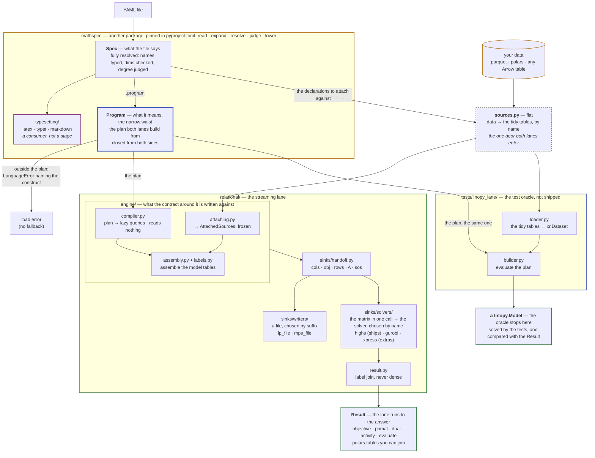

# Architecture

How the package is put together, for anyone who changes its structure or adds
a sink or an operator. A PR that changes the structure described here updates
this page. What the language may say is
[mathspec's](https://mathspec.readthedocs.io/en/latest/about/limits/), and
[Verification](verification.md) is how we know a build is right.

`python examples/walkthrough.py` runs the pipeline below stage by stage. Its
output is committed as
[examples/walkthrough.out](https://github.com/fluxopt/specsolve/blob/main/examples/walkthrough.out)
and asserted line for line by `tests/test_walkthrough.py`.

## The pipeline

A spec is a **closed AST known before any data is touched**. So it can be
built two ways that mean the same thing: by the package, as a plan streamed to
a sink, and by the test suite, as a `linopy.Model`. The package's build is the
*relational lane* (`relational/`). The test suite's is *the oracle*
(`tests/linopy_lane/`).

- **The language is another package.** `mathspec` reads, expands, resolves
  and judges a file, and lowers it to a `Program`. It cannot import anything
  here, so what a spec means cannot depend on what is done with it.
- **Data enters through one door, and both lanes use it.**
  `sources.tidy_sources` reads every shape [the data contract](../reference/data.md)
  accepts into tidy polars tables, and `assumptions.py` checks what a spec
  assumes of its values there. Nothing above the door has seen a value.
- **The lanes take the same things and hand back different things.** Both
  accept the same file, attach the same tables and refuse the same constructs.
  The relational lane reads back a `Result`. The oracle stops at the
  `linopy.Model`, which the tests solve.
- **One gate decides what either lane builds.** `inputs.lowered` returns a
  `Program` or raises `LanguageError`, and both lanes call it. `LanguageError`
  is decidable without data, and `DataError` is what a source failed to
  supply. A spec the language accepts and this lane cannot build raises
  `SpecsolveError` itself, naming the rewrite.
- **Thirteen modules sit outside a fence**, because both halves use them:
  `sources.py`, `assumptions.py`, `api.py`, `strategy.py`, `axes.py`,
  `sweep.py`, `inputs.py`, `frames.py`, `archive_layout.py`, `archive.py`,
  `types.py`, `errors.py` and `messages.py`. A module only one lane reaches
  is that lane's.

## The Python surface

**Three modules hold the surface.** `specsolve` holds what a caller calls,
`specsolve.types` what a call returns, and `specsolve.errors` what a call
raises or warns. Every other module is internal, and any release can change it.

**Nothing on the surface constructs math or reaches the plan.** The YAML file
is the model, and Python runs it: the five verbs `check`, `build`,
`evaluate`, `solve` and `write`, the fold `solve_over` with its two axes,
`tidy`, and the readers of an archive. Loading and typesetting a spec are
`mathspec`'s. `specsolve.errors` re-exports the language's errors, because a
caller meets them without choosing to.

**Every type a call returns is importable from `specsolve.types`**, down to the
rows it holds, so a caller that wraps the package can write its types down.
`tests/test_architecture.py` pins each module's `__all__` in both directions,
and [the Python API](../reference/api.md) renders the docstrings, which are the
reference.

## Hard rules

*`tests/test_architecture.py` encodes these as static checks, and CI's
bare-install job proves the dependency claims.* They constrain the language
and the layers. What a build costs is measured in
[the benchmarks](../about/benchmarks.md), and is not a rule.

0. **The layers are ordered, and imports prove it.** Every module imports only
   downward, at module level. `DELIBERATE_LAZY_IMPORTS` in
   `tests/test_architecture.py` is empty, and an undeclared in-function import
   fails the build.
1. **Core AST is the whole language, and the language is upstream.** Macros
   and named expressions are substituted away before dispatch, unless a named
   expression states `cases:`. A `piecewise:` block is expanded by the caller
   (`Spec.expand`) before the door. The AST that crosses is fully resolved, so
   a lane cannot hold its own opinion about what a name refers to. Every
   `mathspec` import names the package, never a module inside it.
2. **The engine knows nothing about linopy, xarray or YAML.** `engine/` is the
   implementation. `sinks/`, `status.py` and the plan vocabulary are what it
   answers to, and no contract module names a module inside it. The engine
   imports nothing from the package but `errors.py` and `messages.py`
   (`ENGINE_MAY_IMPORT`).
3. **One language, two builds, and linopy is only the oracle.** Both pass
   `inputs.lowered`, and no operator registry exists that could make them
   differ. Nothing under `src/` imports linopy. Accepting is not building: the
   three files that build on one side only are in
   [Verification](verification.md#the-same-language-but-not-every-build).
4. **A YAML file is self-contained.** No Python-side state may change what a
   file means.
5. **The public interface is a declared spec, not a Python API.** There is no
   API for constructing a spec, no way to hand in a plan, and no registry to
   populate ([the Python surface](#the-python-surface)).

## The plan, node for node

**The plan is the vocabulary both lanes speak.** Each node has one meaning per
lane. This table is what the file writes and what the relational lane's query
does with it. The oracle's linopy call for each row is
[what a construct becomes in the oracle](verification.md#what-a-construct-becomes-in-the-oracle).
`tests/test_docs_site.py` holds it to `mathspec.program.Expression`'s own
subclasses, so no node lacks a row.

**The plan decides what is sayable; the engine only builds.** Every refusal
about the shape of a file is made upstream. The engine raises only its own two
verdicts: `DataError` about the data, and `SpecsolveError` for the one
construct the language accepts and this lane cannot build (#1137).

**Fan-in** says how an output row's slots relate to the input's.
`pieces.fan_in` answers it for every node, and the compiler acts on it:
anything but one-to-one mixes several slots into one row, so absence is pushed
into the operand first ([#1142](https://github.com/fluxopt/specsolve/issues/1142)).

| plan node | the file writes | fan-in | the relational query |
| --- | --- | --- | --- |
| `Constant` | a number | one-to-one | a one-row const piece |
| `Parameter` | a declared name | one-to-one | its table as `(dims…, cval)` |
| `Variable` | a declared name | one-to-one | `(dims…, var_label, coeff=1)`, plus where it exists; at a read, its primal as a const piece with the same presence, a zero at every absent slot under `absence: zero` |
| `Dual` | `dual(c)` | one-to-one | at a read only: the constraint's rows beside its share of the dual vector, a const piece present exactly where a row stands |
| `Negate` | `-x` | one-to-one | the value column negated |
| `Add` | `x + y`, `x - y` | one-to-one | the two piece lists concatenated |
| `Multiply` | `x * y` | one-to-one | a join on the shared dims; two variable factors pair into a quadratic piece |
| `Divide` | `x / p` | one-to-one | a **left** join, so a divisor parameter with no row leaves a null to report; where the divisor is absent, so is the quotient; a divisor with a reduction under it is added up to one value per coordinate first; at a read, a divisor that is zero makes the quotient absent |
| `Power` | `p ** q` | one-to-one | an inner join and `pow`, each side with a reduction under it added up to one value per coordinate first |
| `Sum` | `sum(x)`, `sum(x, over=d)` | many-to-one | the summed dims projected away — no aggregate |
| `GroupSum` | `sum(x, by=r, over=c, into=d)` | many-to-one | one inner join with the relation's table on the columns the direction consumes and joins on, the consumed dims traded for the produced ones; a bare relation fans a member out to every target |
| `Pullback` | `at(x, by=r, over=d, into=c)` | one-to-one | the same table joined the other way, fanning out |
| `Translate` | `shift(x, along=d, offset=n)` | one-to-one | a remap through the dimension's `ord`, modulo its size under `wrap` |
| `WindowSum` | `sum_back(x, along=d, window=w)` | one-to-many | a row lands at every position whose window reaches it — no aggregate |
| `Cases` | a named expression's `cases:` block | one-to-one | each region's value cut to its own mask and the piece lists concatenated |
| `Named` | the name of an `expressions:` entry | one-to-one | its body, compiled where the name stands |

**A `Cases` is the one node with a mask in a value position.** The language
proves its regions disjoint and total before any data attaches, so an output
row reads exactly one region.

**A read is the one walk where every leaf is a number.** A named expression is
evaluated after the solve: a variable compiles to its primal and `dual(c)` to
the constraint's duals, so any degree reads. `Dual` is the one node a build
refuses.

**Neither reduction aggregates.** A `Sum` drops columns, a `GroupSum` swaps
them and a `WindowSum` replicates rows. Every duplicate collapses once, in the
terminal `SUM(coeff) GROUP BY row, col` at assembly.

## The relational lane

**The spine is one module per box**: `attaching.py`, `compiler.py`,
`assembly.py`, `sinks/`, and `engine.py`, which runs the lifecycle and holds
the solver between solves. `scope.py` sits under them all. The
[module map](#module-map) says what each module does.
`tests/test_compiler.py` compiles a node over empty tables and reads
`.explain()`, because a schema is all a query needs.

**What attaching produces is a value, and so is a build.** `AttachedSources`
and `BuiltModel` are frozen. The variable tables are passed beside them, the
one live registry in the lane. `Assembly` fills during a build and is
discarded once it freezes, so a build that raises leaves no model.

**Tables are tidy.** Parameters are `(dims…, value)`. A variable table is
`(dims…, var_label)`, one row per variable that exists. A linear expression is
`(dims…, var_label, coeff)` plus a constant part. The matrix is COO while
declarations build and CSR at assembly, the three arrays a solver takes. A
mask is a missing row, and broadcasting is a join.

**Order matters only in the labels.**

- **Labels are dense `0..n-1`**, so `var_label` is the solver column and `row`
  the solver row. `update` relies on this: new bounds, costs and right-hand
  sides go onto a loaded solver by position. An update that moves a label is a
  rebuild, and the answer is the same.
- **Labels are row-major over the masked coordinate product**, sorted on the
  declared ordinals, so a build is the same from run to run. Variables and
  constraint rows share one implementation, `labels.frame`.
- **A block over the whole product is addressed, not joined**: a term computes
  its row from its own coordinate.
- **Answers come back in the same order**, through the label table.

**The plan is affine by design.** No node adds variables or constraints as a
side effect. Binary and integer are a column type. `sos:` is a fourth stream
out of the engine. A formulation is a spec transformation, and the language
writes it out (`Spec.expand`).

**A frame is the boundary in both directions.** `frames.py` reads a caller's
table through the Arrow PyCapsule protocol, and a `Result` hands back polars.
So pandas and pyarrow are bridges the caller installs, not dependencies.

**Sinks take four streams**: `cols`, `rows`, `A` in CSR, and `sos`. A sink
declares what it can ingest (`sinks/capabilities.py`), and one with no SOS
concept refuses the model with a pointer to `Spec.expand()`. A **solver** is
chosen by name and a **writer** by suffix, from two closed dicts, `SOLVERS` and
`WRITERS`. A new solver is one module and one line. Solvers share the
projection of `cols` and `obj` on `Handoff`, never hand-off code, because
HiGHS and Xpress take CSR, gurobipy takes CSC, and an optional package must
stay off the import path.

**A quadratic objective goes to the solver whole**, because neither direct API
changes one coefficient at a time. A second `passHessian` replaces `Q` and
leaves the LP loaded, so a moved coefficient is an update and only the sparsity
pattern is structure.

## Module map

| Module | Role |
|---|---|
| `mathspec` (a dependency) | the whole language, read, expanded, resolved, judged and lowered there |
| `api.py` | the runner: the verbs, and `load_result` / `scan_result` |
| `archive_layout.py` | below every verb that solves: what an archive holds |
| `archive.py` | reads an archive back: `load_archive`, `scan_archive` and `load_inputs`; it never writes |
| `inputs.py` | above both lanes: `Buildable` and `Source`, what every verb takes |
| `relational/collect.py` | how polars materialises a frame, for every collect in the package |
| `sources.py` | the one door: caller data read into tidy tables and checked against the declarations |
| `assumptions.py` | the one guard that needs numbers: a spec's `assumptions:` and a curve's conditions, checked against the data |
| `frames.py` | the boundary: caller tables in, via the Arrow PyCapsule protocol |
| `types.py` | public: every type a call returns |
| `errors.py` | public: the error tree, the language's half re-exported |
| `messages.py` | a wording two modules raise, written once |
| `strategy.py` | the driver above the runner: one plan per slice, folded |
| `axes.py` | how a sweep cuts its sources, and the stitch back |
| `sweep.py` | what a fold returns: `Sweep`, its spill on disk, and `load_sweep` / `scan_sweep` |
| `relational/engine/scope.py` | the scope a query is compiled in: the program, its attached data and the variable frames built so far |
| `relational/engine/compiler.py` | plan → lazy queries |
| `relational/engine/relations.py` | a relation's table as a walk reads it, the one place a role becomes a column |
| `relational/engine/shifts.py` | `shift` and `sum_back`: a piece's rows moved along one dimension's own order, and the edge |
| `relational/engine/predicates.py` | a `where:` mask as a boolean query over the coordinate product |
| `relational/engine/pieces.py` | what an expression compiles *to*: the additive pieces and the arithmetic over them |
| `relational/status.py` | solve outcome on two axes |
| `relational/engine/labels.py` | which coordinate gets which solver index |
| `relational/engine/attaching.py` | the door's tables → `AttachedSources` |
| `relational/engine/assembly.py` | one build: every declaration into rows of the model tables, quadratic constraints last |
| `relational/engine/coverage.py` | is the data there where a declaration reads it |
| `relational/engine/readback.py` | a built row, a solve and a named expression, read back in the model's own labels |
| `relational/engine/engine.py` | the lifecycle: build, hand to a sink, read back |
| `relational/result.py` | what a solve returned, read back by label |
| `relational/answer_layout.py` | an answer on disk, and the `ANSWER_LAYOUT` stamp |
| `relational/names.py` | the columns specsolve writes beside a spec's own |
| `relational/sinks/handoff.py` | what every sink reads, and no more |
| `relational/sinks/capabilities.py` | what a sink can ingest |
| `relational/sinks/` | how a built model leaves: `solvers/` by name, `writers/` by suffix ([README](https://github.com/fluxopt/specsolve/blob/main/src/specsolve/relational/sinks/README.md)) |

**`relational/` is one subpackage, and the directory is the rule.** It imports
nothing else from the package but `errors.py` and `messages.py`. No module
imports linopy, and none imports xarray at module level.

## Internal names

The names the code uses for its own parts. The names a caller meets are in
[the glossary](../reference/glossary.md).

**Lane**
: One way to build a spec: the relational lane (`relational/`) or the oracle
  (`tests/linopy_lane/`).

**The door**
: `sources.tidy_sources`, the one function both lanes read data through.

**Lowering**
: Turning a spec into its `Program`, through `inputs.lowered`. `inputs.lower`
  lowers an expression the file never named.

**Attached sources**
: The tidy tables as every query reads them: a dimension as `(val, ord)`, a
  label column as an `Enum` in declared order (`attaching.py`).

**Scope**
: The program, the attached sources and the variable frames built so far
  (`scope.py`).

**Piece**
: One additive part of a compiled expression: linear terms, quadratic terms
  or a constant, each over its dims. An expression compiles to a list of
  pieces (`pieces.py`).

**Presence**
: Where the variable under a piece exists, which a piece's frame cannot say
  on its own (`pieces.py`).

**Region**
: The part of a `cases:` block a piece covers (`pieces.py`).

**Label**
: The solver's index of one column or row. Each declaration owns a contiguous
  run (`labels.py`).

**Coverage**
: Whether data is there where a declaration reads it, checked at the last
  moment a gap is visible (`coverage.py`).

**Collect engine**
: Which polars engine materialises a frame. `collected()` is the one way a
  frame is collected; a build within `IN_MEMORY_REACH` columns and rows uses
  the in-memory engine (`collect.py`, `assembly.py`).

**Handoff**
: The built model as every sink reads it (`handoff.py`).

**Capability**
: Something a model may need a sink to take: integrality, SOS, a quadratic
  objective or constraint (`capabilities.py`).

**Structure digest**
: A digest of everything a re-solve may not change. A loaded solver keeps its
  model while the digest holds and every coefficient is within 1e-12 relative
  of the one it holds (`handoff.py`).

**Kind**
: One frame family of an answer, named after its reader: `primal`, `dual`,
  `expression`, and each output `outputs=` asked for. `OUTPUT_KINDS` is the one
  table (`answer_layout.py`).

**Answer layout** and **archive layout**
: What a result writes, versioned by `ANSWER_LAYOUT`, and what an archive
  adds around it, versioned by `INPUTS_LAYOUT` (`answer_layout.py`,
  `archive_layout.py`).

**Run stamp**
: The `specsolve_run` column an archive adds to every table. Names that start
  with `specsolve_` are reserved (`names.py`).

**Slice**, **stitch** and **spill**
: One model of a sweep; putting windowed frames back over the dimension they
  cut; a sweep's answers on disk instead of in memory (`axes.py`, `sweep.py`).

**Carry** and **the wire**
: One slice's answer copied into the next slice's data; how a slice's sources
  cross to a worker (`strategy.py`).

## Extension checklists

**Add a macro or named expression:** edit YAML. Nothing else.

**Add a sink:** a module in `relational/sinks/solvers/` named for the solver,
with one line in `SOLVERS`, or one in `writers/` keyed by suffix in `WRITERS`.
It keeps its dependency behind an extra, imported inside the function, and
declares what it can ingest as a `Capabilities` descriptor. Nothing above it
changes. The
[README](https://github.com/fluxopt/specsolve/blob/main/src/specsolve/relational/sinks/README.md)
is the full list.

**Add a consumer of the AST** (a renderer, a checker, a report): a package of
its own that depends on `mathspec` and not on this one. If it needs the plan,
it is a lane.

**Add an operator:** two repositories, in this order. First
[in mathspec](https://mathspec.readthedocs.io/en/latest/contributing/#adding-an-operator),
landed and tagged. Then here, against that tag: the oracle's linopy call, the
compiler case, the engine, a differential test through a solver and the LP
writer, and this page if the structure changes.
[The nightly canary](https://github.com/fluxopt/specsolve/blob/main/.github/workflows/canary.yml)
says the two halves have not drifted since.
