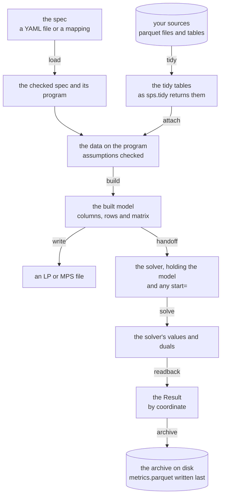

# Making a solve faster

How to solve a model that takes too long, and what each way costs. Find where
the time goes first, then try the ways in the order of the table below: the
first ones keep the answer, the later ones change it.

## Find where the time goes

A model is clocked in nine phases, from the spec as you give it to the archive
on disk. Each phase starts from what the one before it produced, so the
phases add up to the whole call:



Each arrow is one phase, and each box is what that phase produces.
[`Metrics`](../reference/api.md#specsolve.types.Metrics) defines each phase.

Every result carries its clocks. Read them as a table, one row per phase:

```python
result = sps.solve('dispatch.yaml', sources, archive='runs/dispatch.zip')
print(result.metrics.phases)
```

One run of the dispatch example prints:

```text
┌──────────┬──────────┐
│ phase    ┆ seconds  │
│ ---      ┆ ---      │
│ str      ┆ f64      │
╞══════════╪══════════╡
│ load     ┆ 0.001004 │
│ tidy     ┆ 0.003334 │
│ attach   ┆ 0.001061 │
│ build    ┆ 0.008889 │
│ handoff  ┆ 0.012137 │
│ solve    ┆ 0.001125 │
│ readback ┆ 0.006706 │
│ write    ┆ 0.0      │
│ archive  ┆ 0.027854 │
└──────────┴──────────┘
```

This model has 144 columns, so writing the archive is most of its time. On a
model of 300,000 columns, `solve` took 2.4 s of a 2.5 to 2.6 s call
([#2180](https://github.com/fluxopt/specsolve/pull/2180)). A phase that never
ran, here `write`, reads zero.

A saved result and an archive keep the same table, so you can read it later
or on another machine:

```python
print(sps.read_archive('runs/dispatch.zip').metrics.phases)
```

A result holds the time since the model's previous result. The first result
of a model carries the load and the build. A later one carries the update and
the solve that led to it. `model.metrics()` adds up every result
of the model, and also holds writing the archive's last file, which no result
can time.

| Where the time goes | What to try |
|---|---|
| `solve` | [start from an earlier answer](#start-from-an-earlier-answer), [accept a gap](#accept-a-gap), and the ways after it |
| `build` and `handoff`, again on every `update` | [keep the model loaded](#keep-the-model-loaded) |
| `build` on many small models | [build many small models faster](#build-many-small-models-faster) |
| `build` on a large model | [make the model smaller](#make-the-model-smaller) |

## Report a slow phase

Open an issue at
[github.com/fluxopt/specsolve/issues](https://github.com/fluxopt/specsolve/issues)
when one phase takes longer than you expect for the size of your model. The
clocks tell a maintainer where to look, and an archive lets them run your
model again. Write the report in five steps:

1. **Solve the model with an archive.** One file then holds the spec, the
   data, the answer and the clocks.

    ```python
    sps.solve('model.yaml', sources, archive='runs/slow.zip')
    ```

2. **Paste the phases, the model's size and the versions.**

    ```python
    result = sps.read_archive('runs/slow.zip')
    print(result.metrics.phases)
    print(result.metrics.columns, result.metrics.rows, result.metrics.nonzeros)
    print(result.provenance)
    ```

    The provenance names the solver, its version and options, and the
    specsolve and mathspec versions.

3. **Say which phase is slow, and why you expected less.** The best evidence
   is the same model at two sizes. "`build` took 2 s at 1,000 snapshots and
   90 s at 10,000" shows a phase that grows faster than the model.

4. **Attach the archive if you may share the data.** Anyone can solve it again
   from the file alone, with `sps.solve(result.spec, result.sources)`. If you
   may not, attach the spec and give the number of labels in each dimension.

5. **Name the machine.** Give its cores, its memory and its operating system,
   and say whether other work ran during the solve.

A slow `solve` is the solver's own run. Try the ways below before you report
it. Report it when another tool hands the same solver the same model and it
solves faster.

## The ways

| Way | Keeps the optimum | What it costs |
|---|---|---|
| [Keep the model loaded](#keep-the-model-loaded) | yes | only data that leaves every `where:` and label as it was |
| [Start from an earlier answer](#start-from-an-earlier-answer) | yes | can make a solve slower |
| [Build many small models faster](#build-many-small-models-faster) | yes | only below 250,000 columns and rows |
| [Build on one polars thread](#build-on-one-polars-thread) | yes | slows a large model |
| [Accept a gap](#accept-a-gap) | within the gap | the answer is close, not optimal |
| [Relax the integers](#relax-the-integers) | no, a bound | the schedule is fractional |
| [Solve in windows](#solve-in-windows) | no | the windows cannot see past their end |
| [Decompose](#decompose) | within the gap | you write and own the loop |
| [Make the model smaller](#make-the-model-smaller) | no | it answers a different question |

## Keep the model loaded

Build once, then `update` and solve. The solver keeps the model, and the next
solve skips the build:

```python
model = sps.build('dispatch.yaml', sources)
for numbers in steps:
    result = model.update(numbers).solve()
```

An `update` that changes which coordinates a `where:` keeps, or adds a label,
builds and loads again. An `update` that gives a parameter new numbers at the
coordinates it already has, where the parameter is only a bound, a right-hand
side or a cost, also skips most of the build: only the bounds, right-hand
sides and costs it feeds are read again.
[Change it and solve again](../change.md) shows the loop and how to check
that it stays loaded.

## Start from an earlier answer

Each solve in a loop starts from the one before, by default. That is usually
faster, and on some models much slower, because a solver that carries on skips
its presolve. [Starting from an earlier answer](warm-start.md) has the
measurements and shows how to time both ways.

## Build many small models faster

specsolve builds a model of at most 250,000 columns and 250,000 rows on
polars' in-memory engine. To move the rest of a process onto it too, such as a
sweep of many small models and your own queries:

```python
import polars as pl

pl.Config.set_engine_affinity('in-memory')
```

`POLARS_ENGINE_AFFINITY=in-memory` in the environment does the same, and the
workers of a [parallel sweep](parallel.md) inherit it.

## Build on one polars thread

A small model can build faster on one polars thread, and a large model builds
slower. Polars reads the setting when it is imported, so set it in the
environment, or in `os.environ` before the first import of polars or
specsolve:

```bash
POLARS_MAX_THREADS=1 python solve.py
```

The numbers that follow are rough estimates from one 4-core machine. One
thread saved about a quarter of the build time up to 20,000 variables, and
about a tenth from 100,000 to 200,000. At 1,000,000 variables the build took
half as long again
([#2016](https://github.com/fluxopt/specsolve/pull/2016)). On 2 cores, one
thread saved nothing
([#2017](https://github.com/fluxopt/specsolve/pull/2017)). For the best
setting for your model, time both settings on the machine that runs it, each
in a process of its own.

The workers of a [parallel sweep](parallel.md) inherit the setting. It changes
polars only, and the solver keeps its own threads.

## Accept a gap

A MIP solver proves its answer optimal by closing a gap between the answer and
a bound. Most of the time can go into the last part. Stop at 1%:

```python
result = sps.solve('commitment.yaml', sources, solver_options={'mip_rel_gap': 0.01})
```

The option names are the solver's own; [Choosing a solver](solvers.md) shows
how to pass them. The answer is within 1% of the optimum, and it can be a
different schedule.

## Relax the integers

Make the integer variables continuous. The model is then an LP, which solves
faster and has prices:

```python
from mathspec import to_spec

relaxed = to_spec('commitment.yaml').to_dict()
relaxed['variables']['on'] |= {'domain': 'continuous', 'bounds': {'lower': 0, 'upper': 1}}
```

The answer is a lower bound on the cost, not a schedule: a generator can be a
third on. To get prices for the integer answer instead, see
[Prices from a MIP](fix-relax-remove.md#prices-from-a-mip).

## Solve in windows

Solve a long run of snapshots one window at a time. Each window stays the
same size, however many snapshots there are:

```python
sweep = sps.solve_over(
    'storage.yaml',
    sources,
    sps.EachWindow('snapshot', horizon=24, lookahead=12, carry={'soc_initial': 'soc'}),
)
```

A window cannot see past its end, so the schedule costs more than one solve.
A lookahead buys that back, and makes each window larger. The windows run one
after the other, because each one starts where the one before stopped.
[A model too large for one solve](../sweep.md) shows both.

## Decompose

A model that is large because of one part, such as dispatch under an
investment choice, can be split into a small master and a large subproblem.
The answer has a gap that you choose, so stop at 1% and the answer is within
1%. specsolve gives no driver for it, so you write the loop.
[The Benders example](https://github.com/fluxopt/specsolve/blob/main/examples/benders/README.md)
is one, checked against the whole model.

## Make the model smaller

Representative days instead of a year, fewer nodes or fewer weather years
make a smaller model. That is a different model: it answers a different
question, and nothing tells you how far its answer is from the one you asked
for.
