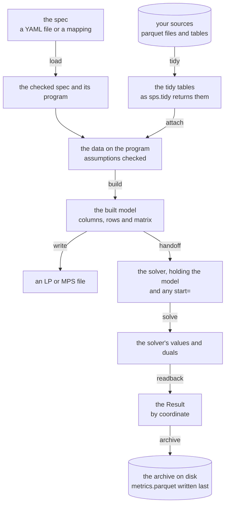

# Finding where the time goes

How to find which phase, which entry and which solve a model spends its time
on. Read this before [Making a solve faster](faster.md): the phase that is
slow decides which way to try.

The spec is `examples/dispatch.yaml`.

```python exec="true" source="material-block" session="timings"
import polars as pl

import specsolve as sps

pl.Config.set_tbl_rows(30)

MODEL = 'examples/dispatch.yaml'
GENERATORS = ['wind', 'solar', 'gas']

sources = {
    'snapshot': range(4),
    'generator': GENERATORS,
    'p_max': pl.DataFrame({'generator': GENERATORS, 'value': [80.0, 0.0, 200.0]}),
    'cost': pl.DataFrame({'generator': GENERATORS, 'value': [10.0, 25.0, 50.0]}),
    'load': pl.DataFrame({'snapshot': range(4), 'value': [60.0, 120.0, 180.0, 90.0]}),
}
```

## The phases of a solve

A model is clocked in nine phases, from the spec as you give it to the archive
on disk. Each phase starts where the one before it ended, so the phases add up
to the whole call:



Each arrow is one phase, and each box is what that phase produces.
[`Metrics`](../reference/api.md#specsolve.types.Metrics) defines each phase.

Every result carries its clocks. Read them as a table, one row per phase:

```python exec="true" source="material-block" result="text" session="timings"
result = sps.solve(MODEL, sources)
print(result.metrics.phases)
```

A phase that never ran, here `write` and `archive`, reads zero. On a model of
300,000 columns, `solve` took 2.4 s of a 2.5 to 2.6 s call
([#2180](https://github.com/fluxopt/specsolve/pull/2180)).

An archive keeps the same row, so you can read the clocks later or on another
machine:

```python
print(sps.read_archive('runs/dispatch.zip').metrics.phases)
```

## Every lap, one row each

[`model.timings()`](../reference/api.md#specsolve.types.Model.timings) logs
every lap the model took, one row each:

```python exec="true" source="material-block" result="text" session="timings"
model = sps.build(MODEL, sources)
model.solve()
print(model.timings())
```

- **`run` counts the results handed back before the lap.** Run 0 ends with
  the first result.
- **`step` says what a lap did inside its phase, and `entry` names the entry
  it built.** The build and the handoff have steps. Elsewhere both are
  null.
- **The rows add up to the metrics.** A phase's rows sum to its clock in
  `model.metrics()`, and a run's rows to the `metrics` of the result that
  ends it.

## The entry a build spends

Filter the log to the build, and sort it, to find the entry that took the
time:

```python exec="true" source="material-block" result="text" session="timings"
print(model.timings().filter(phase='build').sort('seconds', descending=True))
```

The build's steps follow it: `setup`, one `variable`, `set` or `constraint`
row per entry, the `objective`, then `matrix`, which stacks every constraint
into one matrix, and `tables`, the rest of what the solver is handed. An
entry's seconds are its own: they hold when the entries build in another
order.

## The steps of a handoff

The handoff's rows name its steps, the same for every solver:

```python exec="true" source="material-block" result="text" session="timings"
print(model.timings().filter(phase='handoff').select('step', 'seconds'))
```

A first solve runs `start`, `check`, `instance` and `warm`. `start` matches
your `start=` to this build, `check` checks the solver can take the model,
`instance` is a new solver instance taking it, and `warm` gives the solver the
start. The first `instance` in a process also imports the solver's package.

A later solve keeps the solver it holds where only numbers moved, and `push`es
them onto it; otherwise it closes it and takes a new `instance`. A `digest`
row comes only from an `update` that rebuilds the model while a solver is held:
the held solver reads its fingerprint of its model before the rebuild. Two
solves with no `update` between them log no `digest`.

## Each solve of a loop

A model that you update and solve again logs one run per result. Group the
log by run to compare the solves:

```python exec="true" source="material-block" result="text" session="timings"
for load in ([90.0, 150.0, 200.0, 60.0], [30.0, 60.0, 90.0, 45.0]):
    model.update({'load': pl.DataFrame({'snapshot': range(4), 'value': load})})
    model.solve()

per_run = model.timings().group_by('run', 'phase', maintain_order=True).agg(pl.col('seconds').sum())
print(per_run.pivot('phase', index='run', values='seconds'))
model.close()
```

```python exec="true" session="timings"
pl.Config.set_tbl_rows(None)
```

Run 0 holds the load and the first build. Each later run holds its update,
its build and its solve. An archive written by a solve lands in that solve's
run. The result's own row is written into the archive before it lands, so the
run holds the landing and the result does not.

## What the slow phase points to

| Where the time goes | What to try |
|---|---|
| `solve` | [start from an earlier answer](faster.md#start-from-an-earlier-answer), [accept a gap](faster.md#accept-a-gap), and the ways after it |
| `build` and `handoff`, again on every `update` | [keep the model loaded](faster.md#keep-the-model-loaded) |
| `handoff`, in `instance` on every `update` | [keep the model loaded](faster.md#keep-the-model-loaded): only numbers may move |
| `build` on many small models | [build many small models faster](faster.md#build-many-small-models-faster) |
| `build` on a large model | the entry that holds the time, then [make the model smaller](faster.md#make-the-model-smaller) |

## Report a slow phase

Open an issue at
[github.com/fluxopt/specsolve/issues](https://github.com/fluxopt/specsolve/issues)
when one phase takes longer than you expect for the size of your model. The
clocks tell a maintainer where to look, and an archive lets them run your
model again. Write the report in five steps:

1. **Solve the model with an archive.** One file then holds the spec, the
   data, the answer and the clocks.

    ```python
    sps.solve('model.yaml', sources, archive='runs/slow.zip')
    ```

2. **Paste the phases, the model's size and the versions.**

    ```python
    result = sps.read_archive('runs/slow.zip')
    print(result.metrics.phases)
    print(result.metrics.columns, result.metrics.rows, result.metrics.nonzeros)
    print(result.provenance)
    ```

    The provenance names the solver, its version and options, and the
    specsolve and mathspec versions. Where `build` is slow, paste the build's
    rows of `model.timings()` too.

3. **Say which phase is slow, and why you expected less.** The best evidence
   is the same model at two sizes. "`build` took 2 s at 1,000 snapshots and
   90 s at 10,000" shows a phase that grows faster than the model.

4. **Attach the archive if you may share the data.** Anyone can solve it again
   from the file alone, with `sps.solve(result.spec, result.sources)`. If you
   may not, attach the spec and give the number of labels in each dimension.

5. **Name the machine.** Give its cores, its memory and its operating system,
   and say whether other work ran during the solve.

A slow `solve` is the solver's own run. Try [the ways](faster.md#the-ways)
before you report it. Report it when another tool hands the same solver the
same model and it solves faster.
